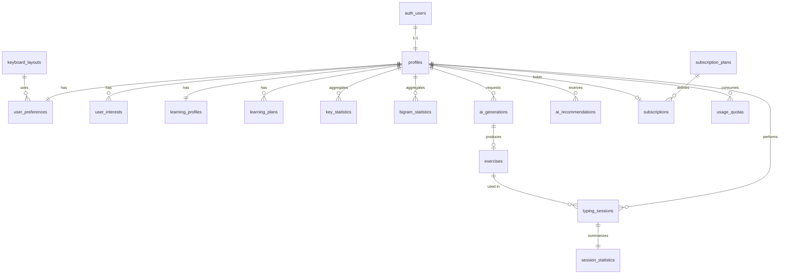

# TypeMind — Modèle de données (MVP)

> v0.1 — Source de vérité : `src/lib/db/schema/*.ts` (Drizzle). Migrations générées dans `supabase/migrations/`.
> Toutes les tables : `id uuid pk default gen_random_uuid()` (sauf mention), `created_at`, `updated_at timestamptz`.
> RLS activée sur **toutes** les tables du schéma `public`.

## Diagramme

## Tables

| Table | Colonnes clés | Contraintes / index | RLS |
|---|---|---|---|
| `profiles` | `id = auth.users.id`, display_name, age_bracket (`14_17`/`18_plus`), onboarding_completed_at | pk = fk auth.users on delete cascade | own, lecture seule |
| `app_admins` | user_id | pk = fk auth.users | own, lecture seule |
| `user_preferences` | user_id, ui_language, content_language, keyboard_layout_id, experience_level, daily_goal_minutes, time_zone, goals text[], sound_enabled, show_virtual_keyboard | unique(user_id) | own, lecture/écriture |
| `user_interests` | user_id, topic_key, custom_label | unique(user_id, topic_key) | own, lecture/écriture |
| `keyboard_layouts` | id text (`fr-azerty`…), name, is_active, sort_order — définitions dans le code (ADR-014) | — | lecture publique |
| `exercises` | kind (`lesson`/`library`/`ai`/`assessment`), language, layout_id null, title, body, topic_key, difficulty 1-10, target_chars text[], owner_id null, source_generation_id null | index(kind, language, difficulty) | publiques (owner null) lisibles ; privées = own |
| `typing_sessions` | user_id, exercise_id, exercise_key (`lesson:…`, `lib:…`, `speed:60`, `assessment:fr`…), layout_id, mode, client_session_id, started_at, ended_at, duration_ms, status | unique(user_id, client_session_id) ; index(user_id, started_at desc) ; index(user_id, exercise_key) | own, lecture seule |
| `session_statistics` | session_id, user_id, net_wpm, raw_wpm, accuracy, keystrokes, correct_keystrokes, correct_chars, corrected_errors, uncorrected_errors, consistency, wpm_timeline jsonb | pk(session_id) | own, lecture seule |
| `key_statistics` | user_id, layout_id, char, attempts, errors, ewma_latency_ms, ewma_error_rate, last_seen_at | unique(user_id, layout_id, char) | own |
| `bigram_statistics` | user_id, layout_id, bigram, attempts, errors, ewma_latency_ms | unique(user_id, layout_id, bigram) | own |
| `learning_profiles` | user_id, skill_level, current_wpm, current_accuracy, target_wpm, weak_keys text[], weak_bigrams text[], accuracy_trend, wpm_trend, last_practice_at, streak_days, version | unique(user_id) | own (écriture serveur seulement) |
| `learning_plans` | user_id, status, steps jsonb, generated_by_rule_version | index(user_id, status) | own |
| `ai_generations` | user_id, provider, model, purpose, input_tokens, output_tokens, cost_estimate_micros, status, error_code | index(user_id, created_at) | own lecture ; insert serveur |
| `ai_recommendations` | user_id, rule_id, payload jsonb, explanation, dismissed_at | index(user_id, created_at) | own |
| `subscription_plans` | id text (`free`/`pro_monthly`/`pro_yearly`), stripe_price_id, price_cents, currency, interval, entitlements jsonb, is_active | — | lecture publique |
| `subscriptions` | user_id, plan_id, stripe_customer_id, stripe_subscription_id, status, current_period_end, cancel_at_period_end | unique(user_id), unique(stripe_subscription_id) | own lecture ; écriture webhook (service role) |
| `usage_quotas` | user_id, feature (`ai_generation`, `ai_coach_message`), period_start, used, quota_limit | unique(user_id, feature, period_start) | own lecture ; écriture serveur |
| `stripe_events` | id text (event id), type, processed_at | pk = event id (idempotence) | aucun accès client |

## Rétention

- Frappes individuelles : **jamais persistées** côté serveur ; seuls les agrégats.
- `wpm_timeline` : échantillonnage ≤ 1 point/seconde.
- Plan Free : historique de séances visible 7 jours (les agrégats par touche restent pour l'adaptation).
- Suppression de compte : cascade depuis `auth.users` ; export JSON disponible avant.

## Déclencheurs et données de référence

- `on auth.users insert` → `handle_new_user()` (SECURITY DEFINER, search_path vide) crée `profiles`, `user_preferences`, `learning_profiles`, `subscriptions` (plan `free`). Les métadonnées d'inscription (pseudo, tranche d'âge, langue) viennent du client et sont revalidées dans la fonction.
- Plans et dispositions clavier insérés par migration (`…_handle_new_user.sql`), car nécessaires aussi en production.

## Écritures

Toutes les tables marquées « lecture seule » sont écrites par le serveur via `adminDb()` (ADR-012). Les lectures utilisateur passent par `withUserDb(claims, …)` qui applique la RLS (ADR-004).
